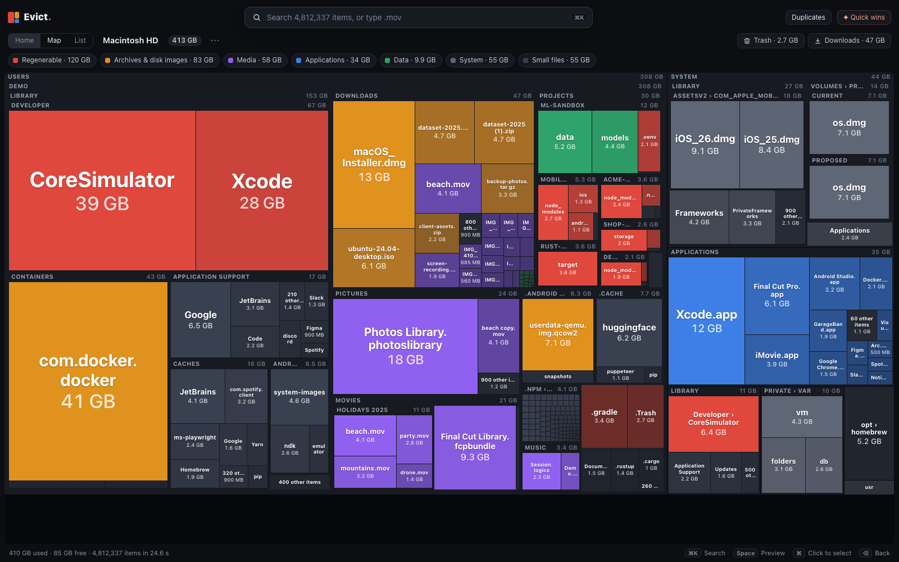

<p align="center">
  
</p>

<h1 align="center">Evict</h1>

<p align="center">
  <b>The bouncer for your disk.</b><br>
  Evict scans your <i>entire</i> Mac in seconds and shows, as proportional boxes<br>
  or a sorted list, what is really taking up space. Search, ask, clean up.
</p>

<p align="center">
  <a href="https://vassilidev.github.io/evict/"><b>Website</b></a> ·
  <a href="https://github.com/vassilidev/evict/releases/latest/download/Evict.dmg"><b>Download</b></a> ·
  <a href="https://github.com/vassilidev/evict/releases">Releases</a>
</p>

<p align="center">
  <a href="https://github.com/vassilidev/evict/actions/workflows/ci.yml"></a>
  
  
  
  
  
</p>




<p align="center"><sub>Screenshots taken on a fictional disk.</sub></p>

## What Evict does

- **The whole disk, fast**: 5.7 million files (426 GB) in 20 s on a Mac mini M4 Pro, and 27 s cold, right after a reboot.
- **A treemap**, finviz-style: each box's area is proportional to the space it takes. Click to drill into a folder, use the breadcrumb to go back up.
- **A list view**: the same folder as a tree sorted by size, with bars and percentages. Expand folders in place to see the biggest items at a glance.
- **Search** (`⌘F` or `/`) across the whole scan: every file and folder whose name matches, biggest first, with their total size. Click a result to jump to it.
- **Filter by extension**: type `.mov .mp4` (or click one of the extensions that weigh the most, listed as soon as you click the search field) to see every video, disk image or archive on the disk.
- **Trash and Downloads at a glance**: two shortcuts in the header show their size and open them in one click, including every Downloads folder on the disk. Items you move to the Trash from Evict show up there, and **Empty Trash…** frees the space for good.
- **Ask Claude** what a folder or file is: what it is, which app creates it, whether it's safe to delete (✅ / ⚠️ / ⛔) and how to clean it properly. Nothing is ever deleted for you.
- **✦ Quick wins**: a personal cleanup plan for the whole disk. Evict sends Claude a digest of the scan (the folder tree down to about 1 GB, regenerable folders, large files) and gets back the safest, biggest gains first, what needs your judgment and what to leave alone, with each app's own cleanup command.

  In the app, answers come from your local [Claude Code](https://claude.com/claude-code) and stream into a side panel as they're written, formatted, with every path clickable to jump to it in the map. Claude Code runs Opus at low effort (a quick wins plan in about 20 seconds) and without any tools, so it can only answer. Without it, or in the browser, the prompt is copied, ready to paste into any AI chat.
- **Colors that tell you something**:
  - 🟥 **regenerable**: caches, `node_modules`, DerivedData, builds, `.venv`…
  - 🟧 **archives and disk images**: zip, dmg, iso, VM images…
  - 🟪 **media**, 🟦 **apps**, 🟩 **data**, ⬛ **system**

  Click a category to highlight it.
- **Select many, delete once**: checkboxes in the list and in search results, `⌘`-click on the map, `Shift`-click for a range, **Select all** on a search (`.mov`, `node_modules`…). The selection stays while you search and browse; a bar shows its total size, lets you review it, show it in Finder or delete it all at once.
- **Built-in cleanup** (app): move to Trash, delete permanently or empty the Trash. The administrator password is only asked for when needed, and system paths are protected.
- **Show in Finder** for any file or folder.
- **Hide a folder** (`System`, for example) to give the rest more room. The choice is remembered across scans.
- **Built-in updates**: Evict checks GitHub for new versions at launch and every 6 hours, tells you when one is out, and installs it in one click.
- **100% local**: the scan never leaves your Mac. No telemetry, no dependencies, just a C scanner and an HTML page. The only network requests are the update check against GitHub and, when you click **Ask Claude** or **Quick wins**, that prompt (paths and sizes from the scan, never file contents).

## Install

### Download

**[⬇ Download Evict.dmg](https://github.com/vassilidev/evict/releases/latest/download/Evict.dmg)** (macOS 13+, Apple Silicon and Intel). Open the DMG, then drag Evict into Applications.

Evict is signed with a Developer ID and notarized by Apple, so it opens like any other app.

> **On first launch**, Evict asks for **Full Disk Access**. Without it, macOS interrupts the scan with one permission prompt per protected folder (Desktop, Documents, other apps' data…). Click **Open System Settings**, turn Evict on, and the scan starts by itself. **Scan Anyway** is still available.

### Updates

Updates come from [GitHub Releases](https://github.com/vassilidev/evict/releases), not from git: each release ships the signed DMG built by CI. Evict checks for a new version at launch and every 6 hours. When one is out, it tells you once, then keeps an **Update** button in the toolbar. **Install and Relaunch** downloads the DMG, checks it really contains Evict, swaps the app in place and reopens it. You can also use **Evict → Check for Updates…** in the menu bar, or update from a terminal:

```sh
/Applications/Evict.app/Contents/MacOS/Evict --update
```

### Build from source

Requirements: macOS 13 or later, and Apple's command line tools (`xcode-select --install`).

```sh
git clone https://github.com/vassilidev/evict.git
cd evict
./install.sh
```

`install.sh` builds Evict.app, installs it in `/Applications` (or `~/Applications`), then opens it. After that, launch Evict from Spotlight whenever you like, and press **⌘R** to rescan. To update a build from source, `git pull && ./install.sh`; the in-app updater also works and replaces it with the latest release.

### Command line

```sh
./evict              # the whole disk, report opened in your browser
./evict ~/Projects   # a single folder
```

In the browser, a web page can't delete files, drive Finder or run Claude Code, so the menu copies text instead: **Copy rm -rf command**, an `open -R` command for **Show in Finder**, and the prompt for **Copy AI prompt**.

## Usage

| Action | Result |
| --- | --- |
| Click a folder | Drill into it (map) · expand it in place (list) |
| Double-click a folder (list) | Drill into it |
| Click a file · right-click · `⋯` | Menu: open, show in Finder, copy path, ask AI, hide, delete |
| **Map** / **List** | Switch views (remembered) |
| `⌘F` or `/` | Search files and folders · `Esc` clears |
| Checkbox · `⌘`-click · `Shift`-click · `⌘A` | Select · add to the selection · select a range · select every row shown |
| `Esc` with a selection | Clear the selection |
| `.mov .mp4` in the search field | Filter by extension |
| **Trash** / **Downloads** | Open them · **Empty Trash…** when you're in the Trash |
| **Ask Claude** / **Copy AI prompt** | Ask what the current folder is |
| **✦ Quick wins** | A personal cleanup plan for the whole disk |
| Click a path in Claude's answer | Jump to it in the map |
| `⌫` or `Esc` | Go up one level |
| Click a category | Highlight it |
| "N hidden" button | Show hidden folders again |
| `⌘R` (app) | Rescan |

## Why it's fast

Measured on the same Mac (Apple M4 Pro, internal SSD, 5.7 M entries):

| Method | Time |
| --- | ---: |
| Python, `os.scandir` + `lstat`, 1 thread | 153 s |
| First C version: full paths, global work queue, 36 threads | 41 s |
| **Evict**: `getattrlistbulk` + `openat`, 8 threads | **20 s** (27 s cold) |

1. **`getattrlistbulk(2)`**: one system call returns the name, type, allocated size and link count of hundreds of entries at once. There is no `stat()` per file.
2. **`openat(parent, name)`**: no full path is ever resolved, so threads don't fight over the kernel nodes of `/` and `/Users`.
3. **A local stack per thread** (depth-first): work is only shared when a thread is idle.
4. **8 threads, measured**: beyond that, APFS saturates on its internal locks. At 24 threads, kernel time climbs to 309 s cumulated while the scan gets *slower*.
5. **No iCloud downloads**: with `IOPOL_MATERIALIZE_DATALESS_FILES_OFF`, iCloud or Drive files that aren't downloaded are never fetched during the scan.
6. **Real size on disk** (`ATTR_FILE_ALLOCSIZE`): hard links are counted once, and files under 1 MB are grouped. A whole-disk report weighs about 3 MB.
7. **Nothing is counted twice**: the Data volume, reachable through firmlinks, and volumes from other containers are skipped.
8. **No endless wait**: if a folder stays blocked behind a macOS permission prompt, the scan stops after 30 s without progress and returns partial results, with a warning.

## Under the hood

```
scan.c        scanner (C, no dependencies)  →  JSON of the pruned tree
index.html    interface (plain HTML/CSS/JS) ←  data injected into the page
app/          macOS app (SwiftUI + WKWebView, JS ↔ native bridge, self-updater)
evict         CLI script: scan + page + open in the browser
build.sh      builds a universal Evict.app (Apple Silicon + Intel); "./build.sh dmg" makes the DMG
minify.py     minifies the page shipped in the app (esbuild), the repo keeps the readable source
install.sh    builds and installs Evict.app
test.sh       checks the scanner's total against `du` on a test folder
docs/         website (GitHub Pages) and README images
```

Every push runs the [CI](.github/workflows/ci.yml): scanner test, universal build, DMG. Pushing a `v*` tag runs the [release workflow](.github/workflows/release.yml), which builds the DMG and attaches it to the GitHub release. The app's built-in updater then picks it up.

```sh
# bump CFBundleShortVersionString in app/Info.plist, commit, then:
git tag v1.6.0 && git push origin v1.6.0
```

## Known limitations

- **macOS only for now**: [Linux](https://github.com/vassilidev/evict/issues/1) and [Windows](https://github.com/vassilidev/evict/issues/2) are planned.
- **APFS clones**: they are counted at full size, so the total can exceed the space actually used.
- **Snapshots**: APFS and Time Machine snapshots aren't visible. They show up in the "Invisible" box.
- **Search** only finds items of 1 MB or more: the scanner groups smaller files into "other items" to keep the report light.

## Roadmap

- [ ] [Native Linux support](https://github.com/vassilidev/evict/issues/1): `getdents64` + batched `statx` through io_uring, WebKitGTK
- [ ] [Native Windows support](https://github.com/vassilidev/evict/issues/2): direct NTFS MFT reading, WebView2

## License

[MIT](LICENSE).
