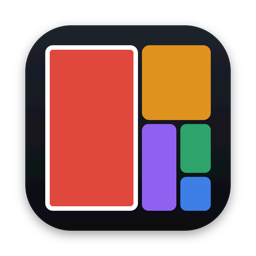
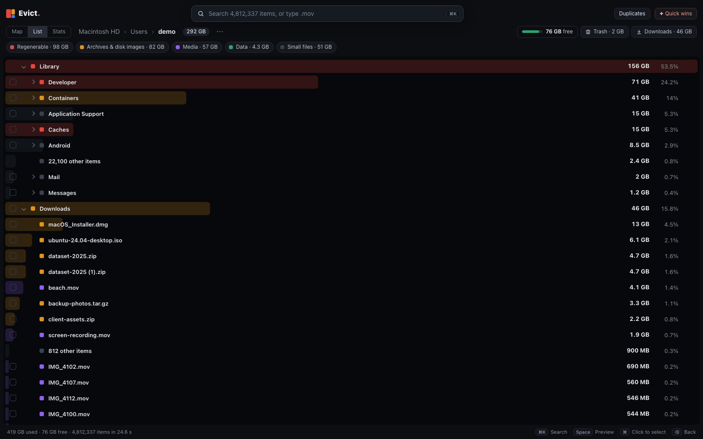
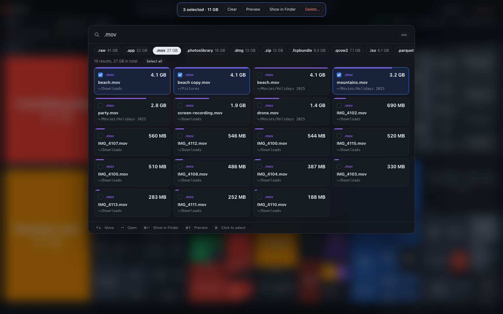

<p align="center">
  
</p>

<h1 align="center">Evict</h1>

<p align="center">
  <b>The bouncer for your disk.</b><br>
  Evict reads your whole disk in seconds and shows where every gigabyte went:<br>
  a map, a list, the duplicates, the caches you can drop. Then it helps you clean up, safely.<br>
  Native on macOS and Linux.
</p>

<p align="center">
  <a href="https://vassilidev.github.io/evict/"><b>Website</b></a> ·
  <a href="https://vassilidev.github.io/evict/download.html"><b>Download</b></a> ·
  <a href="https://github.com/vassilidev/evict/releases">Releases</a>
</p>

<p align="center">
  <a href="https://github.com/vassilidev/evict/actions/workflows/ci.yml"></a>
  
  
  
  
  
  
</p>


<table>
  <tr>
    <td width="33%"></td>
    <td width="33%"></td>
    <td width="33%"></td>
  </tr>
  <tr>
    <td align="center"><sub>The list</sub></td>
    <td align="center"><sub>Search (<code>⌘K</code>, <code>Ctrl K</code> on Linux)</sub></td>
    <td align="center"><sub>Duplicates</sub></td>
  </tr>
</table>
<p align="center"><sub>Screenshots taken on a fictional disk.</sub></p>

## What Evict does

### See where the space went

- **A map**, finviz-style: each box is as big as the space it takes. Click to go inside, use the path bar (with the folder's size) to go back up, click the logo to see the whole disk again.
- **A list**: the same folder as a tree sorted by size, each row drawn over a bar of its size and color, folders expanded in place.
- **Colors that tell you something**: 🟥 regenerable (caches, `node_modules`, DerivedData, builds, `.venv`…), 🟧 archives and disk images, 🟪 media, 🟦 apps, 🟩 data, ⬛ system. Click a category to highlight it.
- **Dependency folders count as one block**: `node_modules`, `vendor`, `.venv`, `Pods`, `site-packages`… are added up without keeping the thousands of folders inside, which halves the report on a developer's disk.

### Find anything in a keystroke

- **Search** (`⌘K`, `⌘F` or `/`; `Ctrl` instead of `⌘` on Linux): a palette over the blurred map. With nothing typed it lists the largest files of the disk; otherwise every file and folder whose name matches, biggest first, as cards with their size, location and a size gauge. `↑` `↓` to move, `↵` to jump to the item, `⌘↵` to show it in Finder (or the file manager on Linux), `⌘Y` to preview it.
- **Filter by extension**: type `.mov .mp4`, or click one of the extensions that weigh the most, right under the search field.
- **Preview anything**: `Space` on a file, like in the Finder. On macOS, Quick Look opens photos, videos, PDFs, Office and iWork documents, text, CSV, code and audio; on Linux, GNOME Sushi does when it's installed, otherwise the default app opens the file. **Show contents** lists what's inside zip, rar, 7z, tar.gz, iso and other archives, biggest files first (on Linux through `bsdtar` from libarchive when installed, GNU `tar` otherwise). **Open with default app** opens the file.

### Clean up without regrets

- **Duplicates, compared by content**: files of the same size and type are checked by their start, middle and end, by kind (videos, photos, audio, archives, documents). Each set keeps one copy, and **Select extra copies** picks the others. On macOS, APFS clones, which share their space with the original, are flagged: deleting them frees nothing.
- **Select many, delete once**: checkboxes in lists and search results, `⌘`-click on the map, `Shift`-click for a range, **Select all** on a search. The selection stays while you search and browse; a bar shows its total size, lets you review it, preview it, show it in Finder or delete it all at once.
- **Trash and Downloads one click away**: shortcuts show their size (`~/.Trash` on macOS, `~/.local/share/Trash` on Linux), items you move to the Trash from Evict show up there, and **Empty Trash…** frees the space for good.
- **Built-in cleanup** (app): move to Trash or delete permanently. The administrator password is only asked for when needed, once for a whole selection (on Linux through `pkexec`, the desktop's polkit prompt).
- **✦ Quick wins**: a personal cleanup plan for the whole disk. Evict sends Claude a digest of the scan (the biggest folders, regenerable folders, large files) and gets back the safest, biggest gains first, with each app's own cleanup command, what needs your judgment and what to leave alone.
- **Ask Claude** what a folder or file is: what it is, which app creates it, whether it's safe to delete (✅ / ⚠️ / ⛔) and how to clean it properly.

  In the app (macOS and Linux), answers come from your local [Claude Code](https://claude.com/claude-code) and stream into a side panel, formatted, with every path clickable. Claude Code runs Opus at low effort (a quick wins plan in about 20 seconds) and without any tools, so it can only answer: nothing is ever deleted for you. Without it, or in the browser, the prompt is copied, ready to paste into any AI chat.

### Safe and private

- **Careful with secrets**: `~/.ssh`, `~/.gnupg`, `~/.aws`, `~/.kube`, the macOS keychains and the Linux keyrings can't be deleted. Before any deletion, Evict looks inside for `.env` files, private keys (`.pem`, `.key`, `.p12`, `id_rsa`…) and credentials, and lists them in the confirmation: they're often in no git repository or backup.
- **Protected paths**: the disk root, top-level and home folders, system folders (`/System`, `/usr`, `/etc`, `/boot`, `/proc`…), `~/Library` on macOS and `~/.config`, `~/.local` on Linux are never offered for deletion.
- **100% local**: the scan never leaves your computer. No telemetry, no dependencies, just a C scanner and an HTML page. The only network requests are the update check against GitHub and, when you click **Ask Claude** or **Quick wins**, that prompt (names and sizes from the scan, never file contents).
- **Hide a folder** (`System`, for example) to give the rest more room. The choice is remembered across scans.

### Fast

- **The whole disk in about 20 s on macOS**: 5.7 million files (426 GB) on a Mac mini M4 Pro, 27 s cold, right after a reboot. Linux benchmarks are to come.
- **A light scan screen**: blocks build up while the disk is read, with the real item count, volume, elapsed time and items per second. The animation only moves layers on the GPU, so the scan keeps its full speed.
- **Built-in updates**: Evict checks GitHub for new versions at launch and every 6 hours and tells you when one is out. On macOS it installs it in one click; on Linux, the install command updates it.

## Install

All files, with their SHA-256 checksums, are on the **[download page](https://vassilidev.github.io/evict/download.html)**.

### macOS

**[⬇ Download Evict.dmg](https://github.com/vassilidev/evict/releases/latest/download/Evict.dmg)** (macOS 13+, Apple Silicon and Intel). Open the DMG, then drag Evict into Applications.

Evict is signed with a Developer ID and notarized by Apple, so it opens like any other app.

> **On first launch**, Evict asks for **Full Disk Access**. Without it, macOS interrupts the scan with one permission prompt per protected folder (Desktop, Documents, other apps' data…). Click **Open System Settings**, turn Evict on, and the scan starts by itself. **Scan Anyway** is still available.

### Linux

One line, on any distribution:

```sh
curl -fsSL https://vassilidev.github.io/evict/install.sh | sh
```

The script picks the native package for your distribution: apt gets the `.deb`, dnf and zypper the `.rpm`, pacman the Arch package. The package manager installs the dependencies (it asks for your password) and Evict shows up in your app menu. On other glibc distributions, it unpacks the tarball into `~/.local`. Run the same line again to update. To uninstall:

```sh
curl -fsSL https://vassilidev.github.io/evict/install.sh | sh -s -- --uninstall
```

**Requirements**: x86_64 or ARM64, glibc 2.34 or later, WebKitGTK 4.1 (GTK 3). CI installs and starts Evict on Ubuntu 22.04, 24.04 and 26.04, Debian 12 and 13, Linux Mint 21 and 22, Pop!_OS, Kali, Fedora 41 to 43, openSUSE Leap 15.6, Leap 16 and Tumbleweed, Arch, Manjaro, EndeavourOS, Rocky Linux and AlmaLinux 10, on x86_64 and ARM64 (on Rocky and Alma, the installer enables EPEL for WebKitGTK). Debian 11 and Rocky, Alma or RHEL 9 lack WebKitGTK 4.1; musl distributions like Alpine aren't supported.

**Manual install**: every release ships packages for both architectures, listed on the [download page](https://vassilidev.github.io/evict/download.html) with their checksums. Replace `x86_64` with `aarch64` on ARM.

| Distribution | File | Command |
| --- | --- | --- |
| Debian, Ubuntu, Mint, Pop!_OS | `evict-linux-x86_64.deb` | `sudo apt install ./evict-linux-x86_64.deb` |
| Fedora, Rocky, Alma | `evict-linux-x86_64.rpm` | `sudo dnf install ./evict-linux-x86_64.rpm` |
| openSUSE | `evict-linux-x86_64.rpm` | `sudo zypper install --allow-unsigned-rpm ./evict-linux-x86_64.rpm` |
| Arch, Manjaro, EndeavourOS | `evict-linux-x86_64.pkg.tar.zst` | `sudo pacman -U ./evict-linux-x86_64.pkg.tar.zst` |
| Anything else (WebKitGTK 4.1 installed) | `evict-linux-x86_64.tar.gz` | extract it, then run `evict/evict` |

**On Linux**, the app has the same interface as on macOS, with `Ctrl` instead of `⌘`. **Show in folder** opens your file manager (Files, Dolphin, Nemo…) with the item selected, and deletion goes to the desktop's Trash. As a normal user, some folders can't be read (Docker images in `/var/lib/docker`, system logs, other users' homes): that space shows up as "not visible to the scan", and **Rescan as Administrator** reads it all after the polkit password prompt.

### Updates

Updates come from [GitHub Releases](https://github.com/vassilidev/evict/releases), not from git: each release ships the signed DMG and the Linux packages built by CI. Evict checks for a new version at launch and every 6 hours. When one is out, it tells you once, then keeps an **Update** button in the toolbar.

- **macOS**: **Install and Relaunch** downloads the DMG, checks it really contains an Evict signed by its developer, swaps the app in place and reopens it. You can also use **Evict → Check for Updates…** in the menu bar, or update from a terminal:

  ```sh
  /Applications/Evict.app/Contents/MacOS/Evict --update
  ```

- **Linux**: the **Update** button gives you the install command; run it again and the package manager upgrades Evict.

### Build from source

**macOS**: macOS 13 or later and Apple's command line tools (`xcode-select --install`).

**Linux**: a C compiler and the WebKitGTK 4.1 headers:

```sh
sudo apt install gcc libwebkit2gtk-4.1-dev      # Debian, Ubuntu
sudo dnf install gcc webkit2gtk4.1-devel        # Fedora
sudo pacman -S gcc webkit2gtk-4.1               # Arch
```

Then, on both:

```sh
git clone https://github.com/vassilidev/evict.git
cd evict
./install.sh
```

On macOS, `install.sh` builds Evict.app, installs it in `/Applications` (or `~/Applications`), then opens it; press **⌘R** to rescan. On Linux, it builds with `linux/build.sh` and installs Evict into `~/.local`, with its entry in the app menu. To update a build from source, `git pull && ./install.sh`.

### Command line

```sh
./evict              # the whole disk, report opened in your browser
./evict ~/Projects   # a single folder
```

The report opens with `open` on macOS and `xdg-open` on Linux. In the browser, a web page can't delete files, drive the file manager or run Claude Code, so the menu copies text instead: **Copy rm -rf command**, an `open -R` (macOS) or `xdg-open` (Linux) command for **Show in Finder**, a preview command for **Preview**, `tar -tvf` for **Show contents**, and the prompt for **Copy AI prompt**.

## Usage

`⌘` on macOS is `Ctrl` on Linux.

| Action | Result |
| --- | --- |
| Click a folder | Drill into it (map) · expand it in place (list) |
| Double-click a folder (list) | Drill into it |
| Click a file · right-click · `⋯` | Menu: open, show in Finder (folder on Linux), copy path, ask AI, hide, delete |
| **Map** / **List** | Switch views (the map always opens first) |
| Click the logo | Back to the whole disk, on the map |
| `⌘K`, `⌘F` or `/` | Search palette · `Esc` closes |
| Checkbox · `⌘`-click · `Shift`-click · `⌘A` | Select · add to the selection · select a range · select every row shown |
| `Esc` with a selection | Clear the selection |
| `Space` | Preview the item under the mouse, or the selection (Quick Look on macOS); archives show their contents |
| `.mov .mp4` in the search palette | Filter by extension |
| **Trash** / **Downloads** | Open them · **Empty Trash…** when you're in the Trash |
| **⋯** next to the path | Current folder: show in Finder, copy path, ask Claude, delete |
| **✦ Quick wins** | A personal cleanup plan for the whole disk |
| Click a path in Claude's answer | Jump to it in the map |
| `⌫` or `Esc` | Go up one level |
| Click a category | Highlight it |
| "N hidden" button | Show hidden folders again |
| `⌘R` (app) | Rescan |
| **Rescan as Administrator** (Linux app) | Read the folders a normal user can't |

## Why it's fast

### macOS

Measured on the same Mac (Apple M4 Pro, internal SSD, 5.7 M entries):

| Method | Time |
| --- | ---: |
| Python, `os.scandir` + `lstat`, 1 thread | 153 s |
| First C version: full paths, global work queue, 36 threads | 41 s |
| **Evict**: `getattrlistbulk` + `openat`, 8 threads | **20 s** (27 s cold) |

1. **`getattrlistbulk(2)`**: one system call returns the name, type, allocated size and link count of hundreds of entries at once. There is no `stat()` per file.
2. **`openat(parent, name)`**: no full path is ever resolved, so threads don't fight over the kernel nodes of `/` and `/Users`.
3. **A local stack per thread** (depth-first): work is only shared when a thread is idle.
4. **8 threads, measured**: beyond that, APFS saturates on its internal locks. At 24 threads, kernel time climbs to 309 s cumulated while the scan gets *slower*.
5. **No iCloud downloads**: with `IOPOL_MATERIALIZE_DATALESS_FILES_OFF`, iCloud or Drive files that aren't downloaded are never fetched during the scan.
6. **Real size on disk** (`ATTR_FILE_ALLOCSIZE`): hard links are counted once, and files under 1 MB are grouped. A whole-disk report weighs about 3 MB.
7. **Nothing is counted twice**: the Data volume, reachable through firmlinks, and volumes from other containers are skipped.
8. **No endless wait**: if a folder stays blocked behind a macOS permission prompt, the scan stops after 30 s without progress and returns partial results, with a warning.

### Linux

The same `scan.c`, with the Linux system calls:

1. **`getdents64(2)`** with a 128 KB buffer: a whole batch of entries per call, and `d_type` tells folders apart without any `stat()`. Only files get one `fstatat()`, for their allocated size (`st_blocks`).
2. **`openat(parent, name)`**, a **local stack per thread** and **8 threads**, as on macOS.
3. **Real disks only**: ext4, btrfs, xfs, f2fs, zfs… are read; `/proc`, `/sys`, tmpfs, overlay, network shares, FUSE, snap images and removable media (`/media`, `/run/media`) are skipped. A filesystem mounted twice (bind mounts) is read once, and the disk size adds up every disk read, so a separate `/home` partition counts.
4. **Real size on disk**, folders included, hard links counted once: the total matches `du` (checked in CI on Ubuntu, and by hand on Fedora).

Benchmarks against `gdu`, `dua` and `ncdu` on Linux are to come.

## Under the hood

```
scan.c            scanner (C, no dependencies, macOS and Linux)  →  JSON of the pruned tree
index.html        interface (plain HTML/CSS/JS), shared by the apps and the CLI  ←  data injected into the page
macos/            macOS app (SwiftUI + WKWebView, native bridge, self-updater; Info.plist holds the version),
                  DMG window background (dmg-background.html, rendered to .tiff)
linux/            Linux app (evict.c: GTK 3 + WebKitGTK, same bridge), build.sh, package.sh (Docker build of the
                  release files), smoke.sh (install + start test), desktop entry, polkit policy, nfpm packaging
evict             CLI script: scan + page + open in the browser
build.sh          builds a universal Evict.app (Apple Silicon + Intel); "./build.sh dmg" makes the DMG
minify.py         minifies the page shipped in the apps and the website at deploy time (esbuild)
install.sh        builds and installs the app from source (macOS or Linux)
test.sh           checks the scanner's total against `du` on a test folder
docs/             website (GitHub Pages): home, download page, Linux installer (install.sh), README images
```

Every push runs the [CI](.github/workflows/ci.yml): the scanner test on macOS and Linux, the universal macOS build and DMG, the Linux build in an Ubuntu 22.04 container (the oldest glibc supported) for x86_64 and ARM64 with the `.deb`, `.rpm`, Arch package and tarball, then on each supported distribution, in a container, the [one-line installer](docs/install.sh) installs the package and Evict starts on a virtual display, scans and shows its map ([smoke.sh](linux/smoke.sh)). Pushing a `v*` tag runs the [release workflow](.github/workflows/release.yml): the Linux packages are published as soon as they're built, and the release becomes "latest" once Apple has notarized the DMG. The [website](.github/workflows/pages.yml) is deployed minified from `docs/` on every change.

### Porting to a new platform

The scanner, the page and its JSON are shared; a platform app is a window with a web view, the scanner, and a native bridge. The page talks to it with `window.webkit.messageHandlers.evict.postMessage({action, …})` (WKWebView on macOS, WebKitGTK on Linux; on Windows, WebView2 can provide the same object with a small script that forwards to `chrome.webview.postMessage`).

| Page → app | Fields | The app… |
| --- | --- | --- |
| `copy` | `text` | puts it on the clipboard |
| `reveal` | `path` or `paths` | shows the items in the file manager |
| `open` / `preview` | `path` / `paths` | opens with the default app / shows a quick preview |
| `delete` / `deleteMany` | `path`, `size` / `items: [[path, size]…]` | confirms (secrets listed), trashes or deletes, offers admin rights on failure |
| `emptyTrash` | `path`, `size` | empties the user's Trash, only that exact folder |
| `archive` | `id`, `path` | lists the archive's files |
| `dupes` | `id`, `groups: [[path…]…]` | compares candidates by sampled then full content |
| `ask` / `cancel` | `id`, `prompt` | streams Claude Code's answer / stops the running job |

| App → page | Called with |
| --- | --- |
| `evictLive(progress)` | `{count, bytes}` from the scanner's progress lines, on the scan screen |
| `evictRemoved(paths, freed)` | what was deleted (`true`) or moved to the Trash (`false`) |
| `evictEmptied(path)` | the Trash was emptied |
| `evictAnswer(id, text, kind)` | `kind` is `delta`, `done` or `error` |
| `evictArchive(id, result)` | `{count, total, entries: [[name, size]…]}` or `{error}` |
| `evictDupes(id, result)` | `{sets: [[[path, privateSize]…]…]}`, `-1` when the private size is unknown |

Before the page loads, the app sets `window.evictClaude` (Claude Code found) and `window.evictLang`. The scanner runs as `evict-scan [--progress] [--home DIR] [folder]`: the JSON report on stdout (`os`, `total`, `free`, `count`, `secs`, `date`, `home`, `tree`), progress lines on stderr. The app puts the report in place of `window.DATA = null; /* __DATA__ */` in the page.

```sh
# bump CFBundleShortVersionString in macos/Info.plist, commit, then:
git tag v1.11.0 && git push origin v1.11.0
```

## FAQ

**Can Evict delete something by mistake?** It never deletes on its own: everything goes through a confirmation that lists what will go, with the Trash as the default. The disk root, your home folder, system folders, `~/Library` on macOS, `~/.config` on Linux, keychains, keyrings and folders like `~/.ssh` can't be deleted, and Evict warns you about the `.env` files and keys inside a folder before it goes.

**Does Evict send my files anywhere?** No. The scan stays on your computer; the only request is the update check against GitHub. **Ask Claude** and **Quick wins** are optional and send names and sizes from the scan, never file contents, through your own Claude Code.

**Why Full Disk Access on macOS?** Without it, macOS hides part of the disk (Mail, Messages, other apps' data) and interrupts the scan with a prompt per protected folder. You can still scan without it.

**Why is part of my Linux disk "not visible to the scan"?** A normal user can't read some folders: Docker images, system logs, other users' homes. **Rescan as Administrator** reads them after the polkit password prompt.

**Which Linux distributions work?** Any 64-bit glibc distribution (2.34+) with WebKitGTK 4.1. CI installs and starts Evict on Ubuntu 22.04, 24.04 and 26.04, Debian 12 and 13, Linux Mint 21 and 22, Pop!_OS, Kali, Fedora 41 to 43, openSUSE Leap 15.6, Leap 16 and Tumbleweed, Arch, Manjaro, EndeavourOS, Rocky Linux and AlmaLinux 10, on x86_64 and ARM64. Debian 11 and Rocky, Alma or RHEL 9 lack WebKitGTK 4.1; musl distributions like Alpine aren't supported.

## Known limitations

- **Windows isn't supported yet**: [it's planned](https://github.com/vassilidev/evict/issues/2).
- **Shared blocks**: APFS clones, and reflinks or snapshots on Btrfs and ZFS, are counted at full size, so the total can exceed the space actually used.
- **Snapshots**: APFS and Time Machine snapshots aren't visible. They show up in the "Invisible" box.
- **Search** only finds items of 1 MB or more: the scanner groups smaller files into "other items" to keep the report light.
- **Linux**: no benchmarks yet; musl distributions (Alpine) aren't supported; updates go through the install command, not a one-click update; previews need GNOME Sushi, otherwise the default app opens the file; archives other than tar need `bsdtar` (libarchive).

## Roadmap

- [x] [Native Linux support](https://github.com/vassilidev/evict/issues/1): `getdents64` scanner, GTK + WebKitGTK app, `.deb`, `.rpm`, Arch and tarball packages, one-line installer
- [ ] Linux benchmarks against `gdu`, `dua` and `ncdu`, cold and warm cache, and batched `statx` through io_uring if it's faster
- [ ] [Native Windows support](https://github.com/vassilidev/evict/issues/2): direct NTFS MFT reading, WebView2

## License

[MIT](LICENSE).
